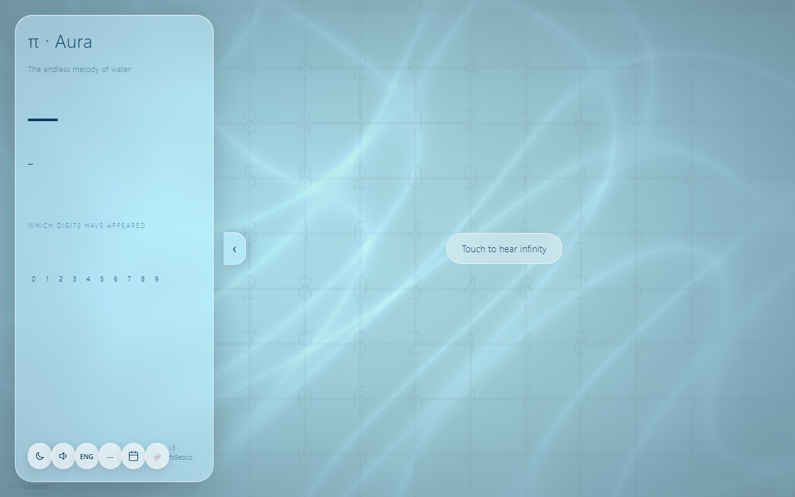
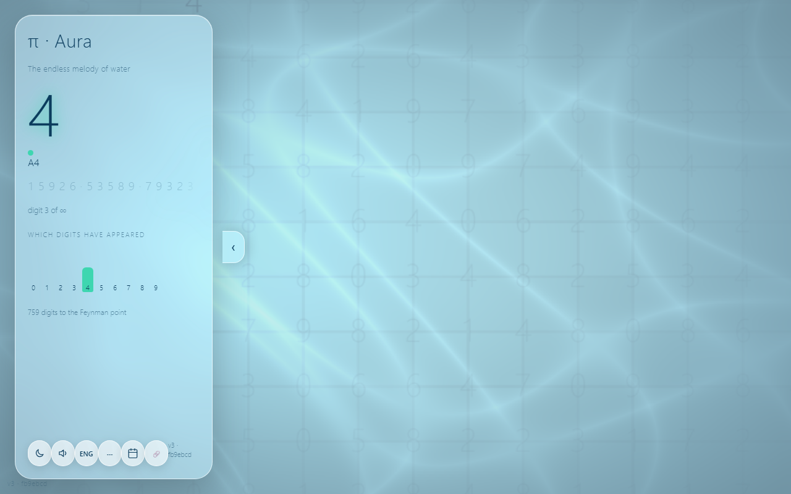
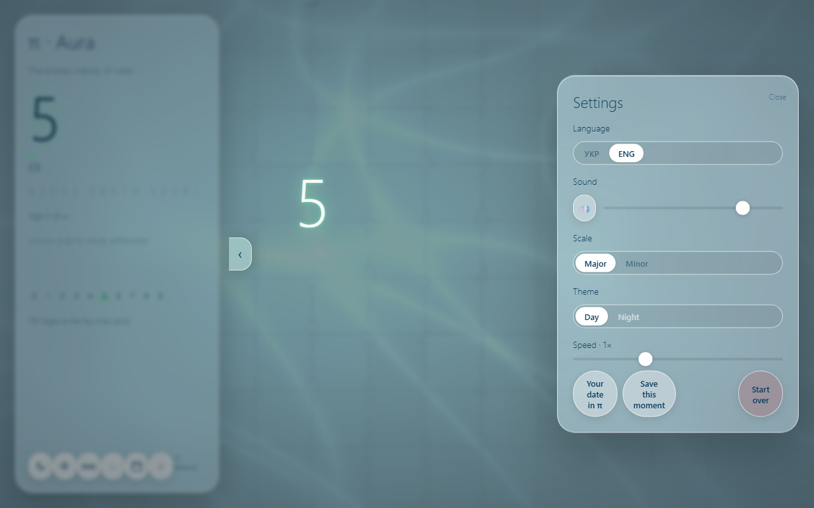
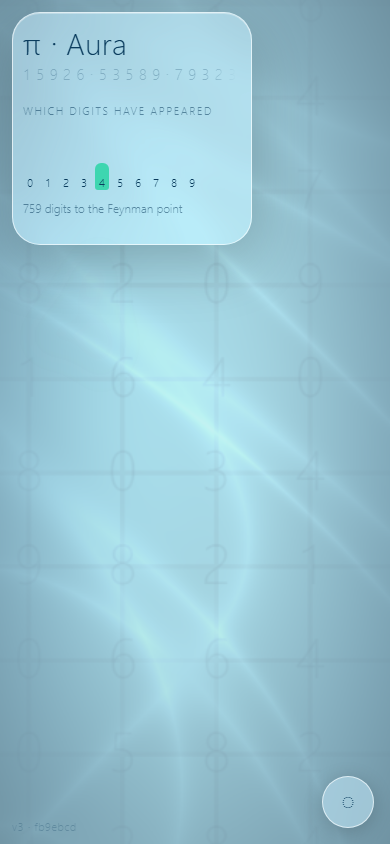
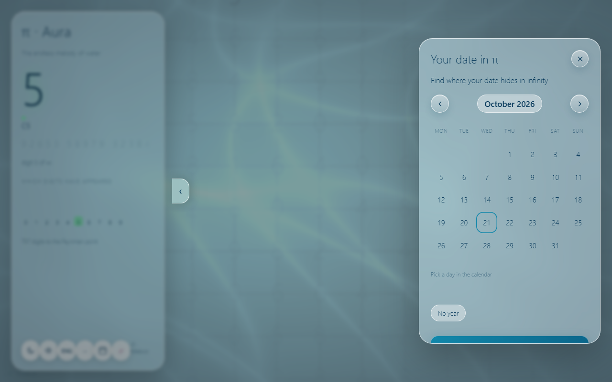

# π · Aura — Infinite melody and glowing water from the digits of π

π · Aura is a single-screen web experience: every digit of π becomes one musical note and one drop of light in a simulated pool of water. Open it in a browser, touch the screen, and the melody begins. There are no Play/Stop buttons, no audio files, and no external dependencies at runtime.

## Screenshots

### Desktop







### Mobile



### Date in π



## Features

- Infinite digits of π generated by a spigot algorithm in a Web Worker.
- Resume position: your place in π is saved in `localStorage` and restored on the next visit.
- Pentatonic scale (major by default, minor available) mapped from digits 0–9 to notes.
- Polyphonic “glass bell in water” voices with procedural reverb and a low drone.
- Special moments: repeated digits, the Feynman point (`999999`), and your date in π.
- Real-time water simulation: ripples, metaballs, caustics, glow, tone mapping, vignette.
- Find your date of birth (or any date) inside the first million digits of π.
- Two languages: Ukrainian (UK) and English (EN), switched instantly without reload.
- Two themes: Day “Aqua” and Night “Deep”.
- Gestures: tap water for an extra note, swipe to change speed, long-press to freeze, device tilt for caustics.
- Keyboard support, reduced-motion support, offline PWA, and WebGL context recovery.

## Tech stack

| Area | Technology |
|---|---|
| Build | Vite + TypeScript |
| Graphics | WebGL2 directly (no three.js), full-screen quad + fragment shaders |
| Audio | Web Audio API (oscillators, compressor, procedural convolution reverb) |
| π digits | Web Worker + Gibbons spigot algorithm; 1,000,000-digit fallback file |
| i18n | Custom mini-module with `uk.json` and `en.json` |
| Tests | Vitest |
| Storage | `localStorage` (language, volume, scale, speed, π position) |
| Deploy | Static `dist/` folder |

## Getting started

```bash
npm install
npm run dev
```

Build and preview the production bundle:

```bash
npm run build
npm run preview
```

Run tests:

```bash
npm test
```

## Project structure

```text
index.html
vite.config.ts
package.json
public/
  sw.js
  manifest.webmanifest
  icon-192.png
  icon-512.png
  pi-1m.bin
src/
  main.ts
  pi/
    piWorker.ts
    piStream.ts
    feynman.ts
    million.ts
    dateSearch.ts
    dateMode.ts
  audio/
    engine.ts
    voices.ts
    drone.ts
    reverb.ts
    scales.ts
  gfx/
    renderer.ts
    sim.ts
    floor.ts
    ripples.ts
    palette.ts
    shaders/
  ui/
    menu.ts
    panel.ts
    gestures.ts
    save.ts
    dateDialog.ts
  i18n/
    index.ts
    uk.json
    en.json
  styles.css
tests/
  pi.test.ts
  scales.test.ts
  i18n.test.ts
  dateSearch.test.ts
  dateMode.test.ts
  ripples.test.ts
  pi1m.test.ts
docs/
  01-initial.png ... 05-date.png
```

## Controls

| Gesture / key | Action |
|---|---|
| First touch | Unlock audio and start the melody |
| Tap water | Extra note (pitch depends on horizontal position) |
| Swipe up / down | Time speed (0.5×–2×) |
| Long press (600 ms) | Freeze water and replay the last 10 digits as an arpeggio |
| Tilt device | Shift caustic highlights (iOS asks for permission on touch) |
| `Space` | Pause |
| `M` | Open menu |
| `←` / `→` | Speed |
| `Esc` | Close menu |

## Date in π

Enter a date in the “Your date in π” dialog. The app searches several common date formats inside the first million digits of π and jumps to the best match. The Feynman point (`999999`) triggers a special chord and a mirror-like water moment.

## Quality

- Target 60 FPS on mid-range phones; `renderScale` adapts automatically.
- `prefers-reduced-motion` reduces motion and disables flashes.
- WebGL context loss is recovered without reloading.
- Offline after the first load (Service Worker + manifest).
- No `console.error` in normal operation.

---


# π · Aura — Нескінченна мелодія та світна вода з цифр числа π

π · Aura — це одне екранне веб-відчуття: кожна цифра числа π стає однією музичною нотою та однією краплею світла в симуляції води. Відкрий у браузері, торкнись екрана — і мелодія почнеться. Жодних кнопок «Грати/Стоп», жодних аудіофайлів, жодних зовнішніх залежностей у рантаймі.

## Скріншоти

### Десктоп


### Мобільний


### Дата в π


## Можливості

- Нескінченні цифри π генеруються алгоритмом «краника» у Web Worker.
- Збереження позиції: твоє місце в π зберігається в `localStorage` і відновлюється при наступному візиті.
- Пентатоніка (мажор за замовчуванням, мінор доступний) — цифри 0–9 перетворюються на ноти.
- Поліфонічні голоси «скляний дзвоник у воді» з процедурною реверберацією та низьким дроном.
- Особливі моменти: повтор цифр, точка Фейнмана (`999999`) та твоя дата в π.
- Симуляція води в реальному часі: хвилі, метаболи, каустики, світіння, тон-мапінг, віньєтка.
- Пошук дати народження (або будь-якої дати) у першому мільйоні цифр π.
- Дві мови: українська (UK) та англійська (EN), перемикаються миттєво без перезавантаження.
- Дві теми: День «Aqua» та Ніч «Deep».
- Жести: торкнись води для додаткової ноти, свайп для швидкості, довге утримання для «заморозки», нахил пристрою для каустиків.
- Підтримка клавіатури, `prefers-reduced-motion`, офлайн-PWA та відновлення WebGL-контексту.

## Технологічний стек

| Область | Технологія |
|---|---|
| Збірка | Vite + TypeScript |
| Графіка | WebGL2 напряму (без three.js), повноекранний прямокутник + фрагментні шейдери |
| Звук | Web Audio API (осцилятори, компресор, процедурна згорткова реверберація) |
| Цифри π | Web Worker + алгоритм Гіббонса; файл на 1 000 000 цифр |
| i18n | Власний міні-модуль з `uk.json` та `en.json` |
| Тести | Vitest |
| Зберігання | `localStorage` (мова, гучність, гама, швидкість, позиція в π) |
| Деплой | Статична папка `dist/` |

## Запуск

```bash
npm install
npm run dev
```

Збірка та попередній перегляд продакшен-бандла:

```bash
npm run build
npm run preview
```

Тести:

```bash
npm test
```

## Структура проєкту

```text
index.html
vite.config.ts
package.json
public/
  sw.js
  manifest.webmanifest
  icon-192.png
  icon-512.png
  pi-1m.bin
src/
  main.ts
  pi/
    piWorker.ts
    piStream.ts
    feynman.ts
    million.ts
    dateSearch.ts
    dateMode.ts
  audio/
    engine.ts
    voices.ts
    drone.ts
    reverb.ts
    scales.ts
  gfx/
    renderer.ts
    sim.ts
    floor.ts
    ripples.ts
    palette.ts
    shaders/
  ui/
    menu.ts
    panel.ts
    gestures.ts
    save.ts
    dateDialog.ts
  i18n/
    index.ts
    uk.json
    en.json
  styles.css
tests/
  pi.test.ts
  scales.test.ts
  i18n.test.ts
  dateSearch.test.ts
  dateMode.test.ts
  ripples.test.ts
  pi1m.test.ts
docs/
  01-initial.png ... 05-date.png
```

## Керування

| Жест / клавіша | Дія |
|---|---|
| Перший дотик | Розблокувати звук і почати мелодію |
| Торкнись води | Додаткова нота (висота залежить від горизонтального положення) |
| Свайп вгору / вниз | Швидкість часу (0.5×–2×) |
| Довге утримання (600 мс) | «Заморозити» воду й відтворити останні 10 цифр арпеджіо |
| Нахил пристрою | Зсув каустиків (iOS просить дозвіл при дотику) |
| `Space` | Пауза |
| `M` | Відкрити меню |
| `←` / `→` | Швидкість |
| `Esc` | Закрити меню |

## Дата в π

Введи дату в діалозі «Твоя дата в π». Застосунок шукає кілька поширених форматів дати серед першого мільйона цифр π і переходить до найкращого збігу. Точка Фейнмана (`999999`) викликає особливий акорд і момент «дзеркальної» води.

## Якість

- Ціль 60 FPS на середніх телефонах; `renderScale` адаптується автоматично.
- `prefers-reduced-motion` зменшує рух і вимикає спалахи.
- Втрата WebGL-контексту відновлюється без перезавантаження.
- Офлайн після першого завантаження (Service Worker + manifest).
- Жодних `console.error` у нормальній роботі.
